# 16 Ways to Verify, Validate, and Calibrate AI Outputs

Sixteen papers make up this week's list. One framework uses a validator to keep AI-generated LEGO builds physically feasible. A second paper benchmarks probabilistic forecasts of atmospheric seeing and finds which method gives the most informative uncertainty. A third uses AI agents with machine-checked formal proofs to discover a faster consensus protocol. A fourth calibrates language model confidence by meaning, using evidence from the model's own probabilities. A fifth learns which verifier error to repair next in Rust proof pipelines. A sixth automates formal verification of AI-generated Python code. A seventh uses adversarial model contracts with a panel vote to enforce output quality. An eighth checks scientific claims from agent-driven research with property-based tests. A ninth formalizes correctness arguments for AI-generated code. A tenth makes neural network controllers inherit safety guarantees by design. An eleventh uses language models to synthesize and verify certificates for nonlinear systems. A twelfth learns when a reasoning model should stop, balancing accuracy and compute. A thirteenth audits behavioral detectors in agent evaluation and finds systematic label disagreements. A fourteenth verifies citations field by field and separates validity from recoverability. A fifteenth evaluates language models against professional ethics codes, clause by clause. A sixteenth detects hallucinated tool calls before execution. The list covers verification, validation, and uncertainty quantification.

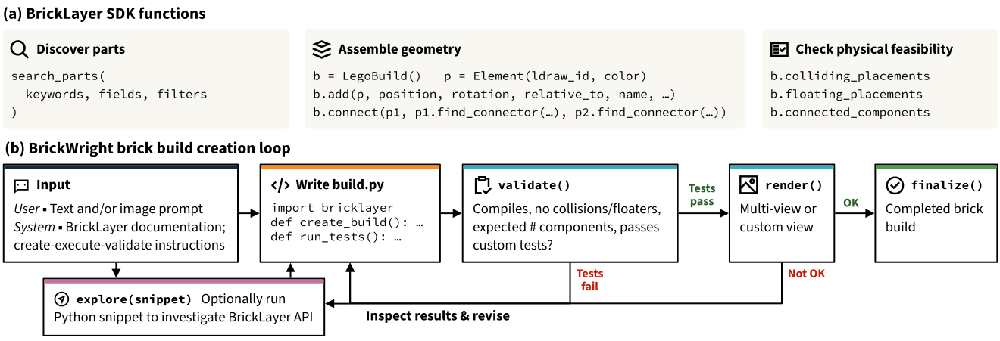

**[BrickWright: Agentic Creation of Physically Feasible Brick Builds](https://huggingface.co/papers/2610.31651)** — AI agents can write code for 3D models. Those models often fail in the physical world. Parts can float, collide, or disconnect. This paper presents BrickWright, a framework for generating physically feasible LEGO builds from text or image prompts. BrickWright guides an agent to write code with BrickLayer, a toolkit written in the Python programming language. BrickLayer offers a simple set of code commands for assembling bricks and a validator. The validator checks that a build uses only real parts, has no collisions, has no floating parts, and forms a connected structure. It sends feedback back to the agent. Baseline agents achieved physical validity rates from 9% to 69%. BrickWright-guided agents achieved 100% validity on 512 prompts. The framework also improved how well lightweight agents followed the prompt and beat specialized models on text-to-brick tasks. The verification contribution is the validator: it checks every build for physical feasibility and returns structured feedback that lets agents correct their designs.

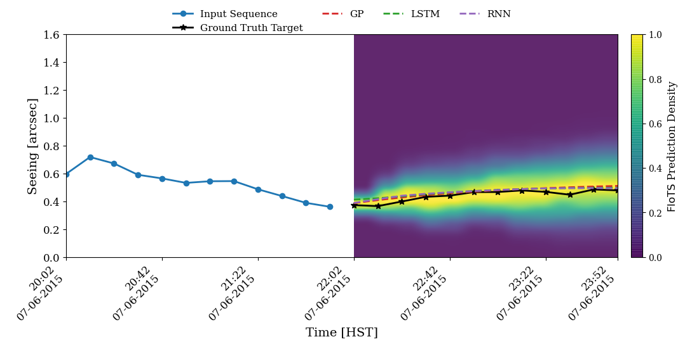

**[Probabilistic Machine Learning for Short-Term Atmospheric Seeing Forecasting](http://arxiv.org/abs/2610.29654v1)** — Atmospheric seeing describes how much air turbulence blurs starlight or laser light. It changes quickly, and forecasts help observatories and optical communication systems plan operations. This paper benchmarks machine learning models for forecasting seeing up to two hours ahead. A probabilistic forecast gives a range of possible values with probabilities, not just one number. The paper compares two probabilistic approaches against deterministic recurrent neural network baselines. A recurrent neural network is a sequence model that processes measurements in order. The first probabilistic approach, Gaussian processes, assumes forecast errors follow a bell-shaped curve. The second, FloTS, uses a normalizing flow, a method that turns a simple probability distribution into a flexible one. Long short-term memory (LSTM) networks, a type of recurrent network, and FloTS gave the best predictive accuracy. FloTS gave the most informative probabilistic forecasts. Gaussian processes gave useful baselines, but their bell-shaped assumption limited them. The uncertainty-quantification contribution is FloTS's flexible predictive distributions: they describe the range of future seeing values more completely than single-number forecasts or Gaussian assumptions.

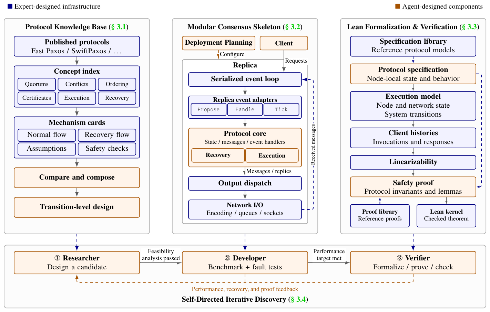

**[The End of Consensus Research?](http://arxiv.org/abs/2610.30114v1)** — Distributed systems keep several servers in agreement about the same data. The protocol that coordinates them is called consensus. Consensus protocols are hard to design and hard to prove correct. This paper introduces AI-greement, a harness that lets AI agents discover, implement, test, and verify consensus protocols. The harness includes a knowledge base, a code skeleton, and a Lean-based verification framework. Lean is a formal proof system in which a machine checks every step of a proof. The framework provides reusable safety definitions, reference specifications, and proofs. Using AI-greement, the paper discovered A-greement, a new protocol. A-greement reduced mean delay by 12.2% to 33.3% compared with the fastest baseline in write-heavy and read-heavy workloads. The Lean formalization also exposed previously unreported vulnerabilities in existing protocols. The verification contribution is the Lean-based framework: it formally proves candidate protocols correct against reference specifications, so the search for new protocols rests on checked proofs rather than informal reasoning. The paper argues that human experts still matter, before, during, and after the search.

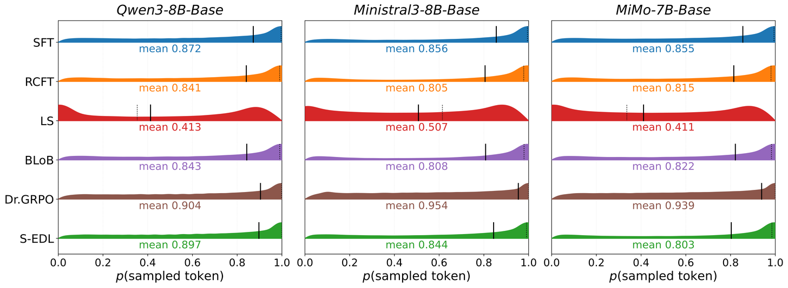

**[S-EDL: Eliciting Self-Evidence from Sequence Likelihoods for Semantic Calibration of LLMs](http://arxiv.org/abs/2610.29832v1)** — Many correct answers can share the same meaning but use different words. Standard calibration methods check fixed multiple-choice options or single strings, so they do not fit open-ended generation. This paper introduces S-EDL, an evidential method for semantic calibration. S-EDL collects evidence from the model's own sequence likelihoods. A sequence likelihood is the probability the model assigns to generating a particular string of words. S-EDL uses this evidence to build a Dirichlet prior over semantic classes. A Dirichlet prior is a distribution that describes how confident the model is across several possible meanings at once. S-EDL then optimizes an evidential loss, a training signal that rewards well-calibrated confidence over variable semantic classes. This approach removes the need for fixed answer options. Evaluations across four open-ended benchmarks and three models show S-EDL reduced semantic calibration error and improved accuracy. Semantic calibration error measures the gap between the model's stated confidence and its actual rate of semantic correctness. The uncertainty-quantification contribution is aligning the model's generative likelihoods with semantic correctness, so the model's confidence reflects whether the meaning, not just the wording, is right.

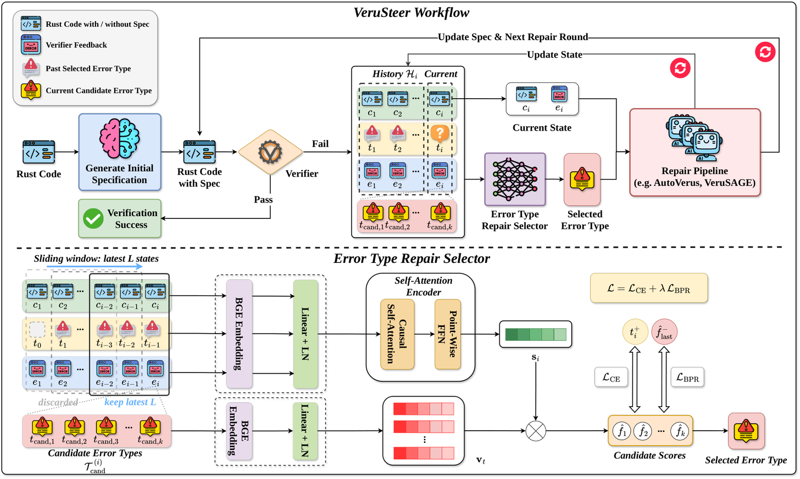

**[VeruSteer: Learning What to Repair Next in Verus](http://arxiv.org/abs/2610.29755v1)** — Verus checks Rust programs against formal specifications. Rust is a systems programming language built for memory safety. When a repair pipeline works on a Rust proof, the verifier often reports several error types at once. Existing pipelines repair these errors in a fixed order. This paper presents VeruSteer, a learned selector that ranks the reported error types. VeruSteer learns from repair trees built offline. Each branch in a repair tree is an alternative repair trajectory from the same starting program. The selector compares branches by verification success, repair rounds, and final verification progress. It combines imitation learning with trajectory preference ranking. Imitation learning trains the selector to copy successful decisions. Trajectory preference ranking prefers branches that verify successfully in fewer rounds. At run time, it uses self-attention over the program, verifier feedback, and earlier selections. Self-attention lets the selector weigh which parts of the program matter most. Across 1,270 test trees, VeruSteer increased verified outcomes from 185 to 194. The verification contribution is the learned selection policy: it chooses which verifier error to repair next from the likely outcome of each alternative trajectory, with no extra repair or verifier calls.

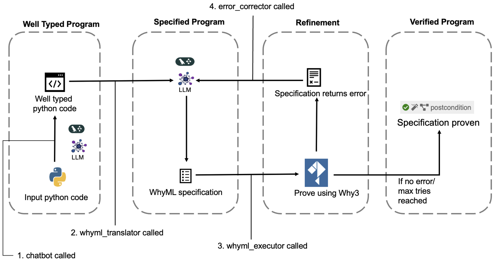

**[TrustedCode: Evaluating Large Language Models for Developing Trusted Code through Automated Program Verification](http://arxiv.org/abs/2610.30432v1)** — About 30% of code written in the Python programming language on GitHub is AI-generated, according to a recent report. Such code can be unreliable. Formal verification checks code against a formal specification, a precise statement of what the code must do. This paper presents TrustedCode, an automated framework for verifying AI-generated Python code. TrustedCode uses large language models to check the types in the code, translate it into WhyML, and verify it with automated theorem provers. WhyML is the input language of the Why3 verification framework. Automated theorem provers are programs that prove mathematical statements automatically. The framework uses chain-of-thought prompting through LangGraph, a library for building agent workflows, to handle model limits in writing specifications and proofs. Chain-of-thought prompting asks the model to reason step by step. In experiments on ten Python programs, 50% of errors came from domain knowledge gaps, 30% from syntactic inaccuracies, and 20% from semantic and data-type issues. The verification contribution is the end-to-end pipeline: it turns AI-generated Python into a formal proof obligation and checks that obligation with a machine proof, so the result does not depend only on the model's word.

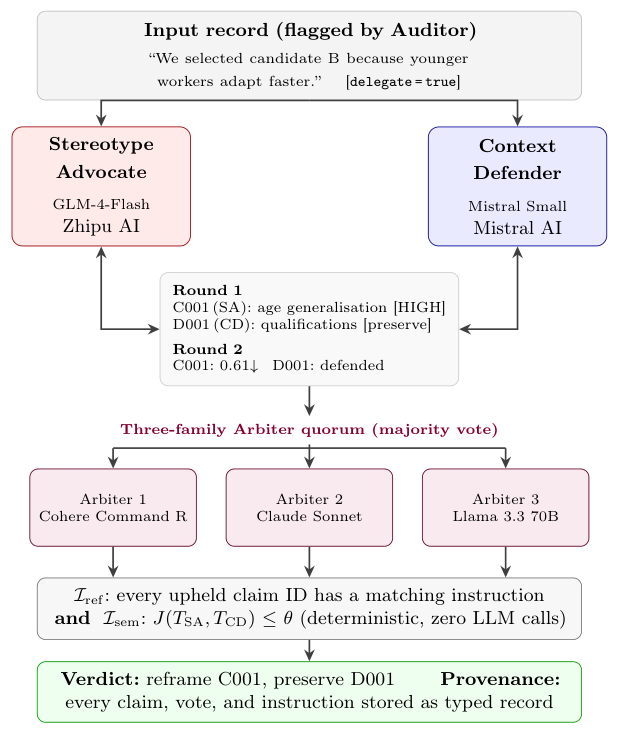

**[Conflicted Records: Typed Adversarial Contracts for Auditable LLM Output Quality Enforcement](http://arxiv.org/abs/2610.29669v1)** — A single record produced by a large language model can be partly right and partly wrong. A grounded fact can sit next to a hallucination. One judge cannot fix this, because the judge shares the biases that created the conflict. This paper presents BiasGuard-D, a verification scheme built on typed adversarial contracts. Two models from different families take opposing roles and exchange typed claim documents. A typed claim document labels each claim so its meaning and source are explicit. A panel of three models then votes on the verdict. A combined referential-plus-semantic invariant validates the final decision. Referential checks compare claims against source material. The semantic check catches verdicts that referential checks miss. On HaluEval QA, the scheme raised right-answer recovery by 49 percentage points. The triage gate required a second auditor from a different model family to keep catching objective hallucinations. Every claim, vote, and instruction is stored as a typed record. The verification contribution is the deterministic check over structured inter-agent records: it catches defects that simple referential checks miss and leaves an audit trail for operators.

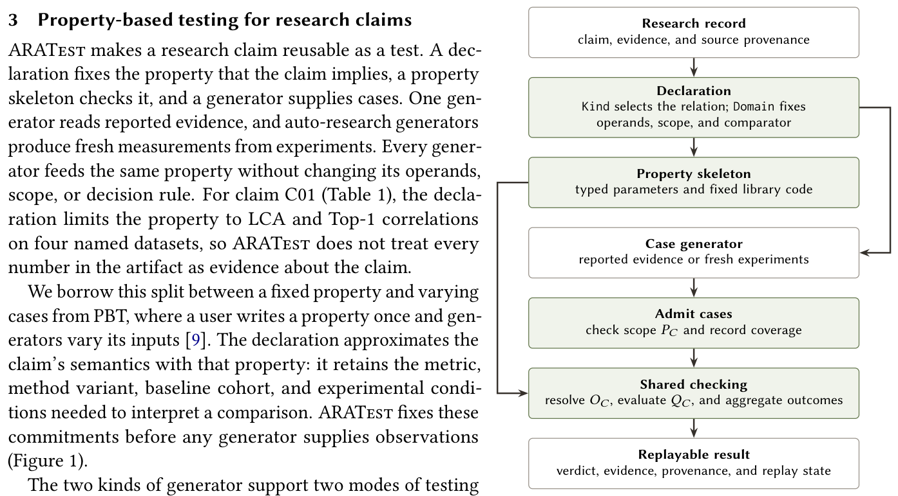

**[From Prose to Properties: Testing Research Claims with ARATest for Agent-Native Science](http://arxiv.org/abs/2610.30495v1)** — AI agents now run experiments and report findings faster than humans can check them. A claim in prose cannot be tested, because no explicit property defines which evidence would falsify it. This paper presents ARATest, a property-based testing library for scientific claims. A property-based test checks a general rule across many generated cases. ARATest abstracts each claim's property skeleton, a parameterized relation that recurs across claims. A typed declaration binds the claim to a skeleton and fixes the compared quantities, cases, scope, and numerical policy. Each test returns one of three verdicts: holds, violated, or inconclusive. Every violation comes with a concrete example that reproduces it. A default generator reads evidence from the research artifacts that agent-driven science produces. Another generator dispatches an agent to run released code for fresh cases. On 243 claims in 33 artifacts, 54 claims received declarations that matched their evidence. Of those, 32 held, eight were violated, and 14 remained inconclusive. Two violations exposed errors in published papers that were later confirmed. ARATest detected all 553 seeded faults without a false alarm on 19 valid controls. The validation-methodology contribution is a single fixed test that checks explicit claim properties against both reported and fresh evidence.

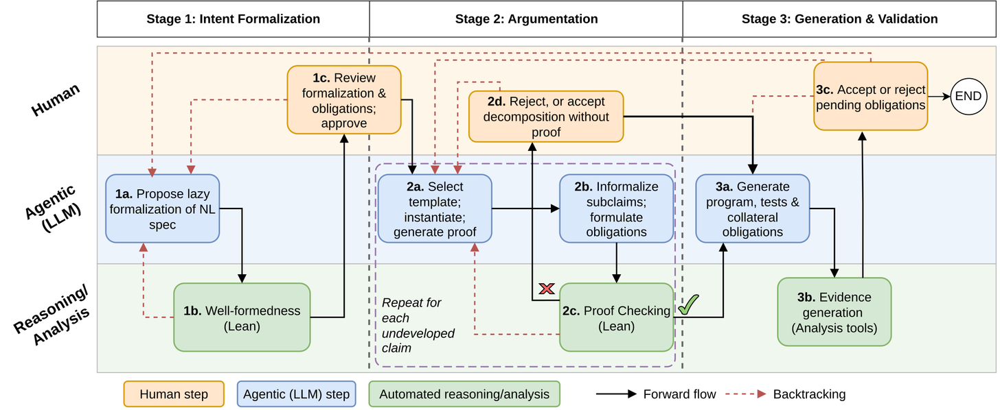

**[AssureCode: Structured Justification for Trustworthy Agentic Coding](http://arxiv.org/abs/2610.29758v1)** — AI tools generate large amounts of code quickly. That code can drift from what the developer intended. Checking it requires more than tests. This paper proposes structured argumentation for AI-assisted software development. It defines a language of justification rationales. A justification rationale explicitly relates the natural language prompt, the formal specification, assumptions about developer intent, and evidence from program analysis tools. This format is structured and verifiable. The idea comes from safety engineering for safety-critical systems, where every safety claim must be backed by evidence. The paper then describes AssureCode, a tool-supported methodology for creating such rationales during code generation by agents. The paper provides an empirical analysis of the implementation and investigates how it contributes to justified assurance of correctness. The verification contribution is the rationale format itself: it makes the correctness argument for AI-generated code explicit and machine-checkable, so a reader can see how generated code connects to the original intent and the evidence that supports it.

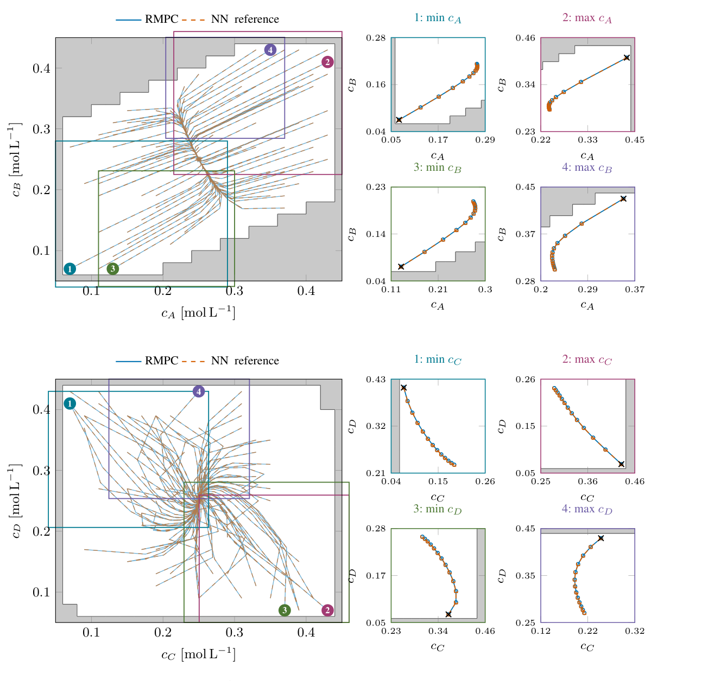

**[Certified Neural Approximation of Robust Nonlinear Model Predictive Control](http://arxiv.org/abs/2610.29559v1)** — Model predictive control is a control method that solves an optimization problem at each step to choose the best action. It performs well but costs a lot of computation online. Neural network controllers run faster, but they can break the original controller's guarantees. This paper presents a framework for generating neural network controllers that provably inherit the safety and stability guarantees of a robust model predictive control policy. The framework treats the approximation error as a bounded input disturbance, a disturbance with a known size limit. The original controller is designed to tolerate that disturbance. This design transfers the guarantees to the neural network directly. The method gives constructive design conditions before deployment. The conditions ensure recursive feasibility and stability. Recursive feasibility means the controller can always find a valid action at the next step. No additional checks after training or online safety filters are needed. Simulations show the learned controller reproduces the original behavior while reducing online computation. The verification contribution is the guarantee transfer: the neural network inherits safety and stability from the model predictive controller by design, not by checking after the fact.

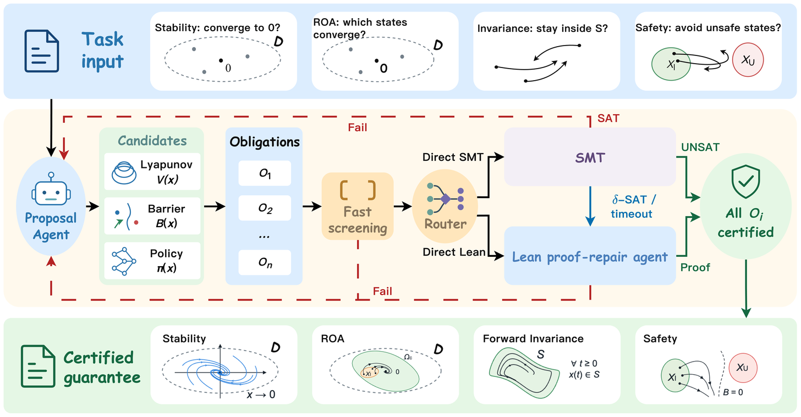

**[LLM2Cert: LLM Synthesis of Certificates with SMT/Lean Verification](http://arxiv.org/abs/2610.30524v1)** — Engineers use Lyapunov functions and barrier certificates to prove that a system is stable or safe. A Lyapunov function measures how energy-like quantities shrink as the system moves toward a stable state. A barrier certificate proves the system never enters an unsafe region. Finding these certificates for nonlinear systems is hard. This paper introduces LLM2Cert, a framework driven by large language models. It synthesizes candidate certificates and verifies them against proof obligations. A proof obligation is a formal statement that the certificate must satisfy. Each obligation goes to an SMT solver or to a Lean proof-repair agent. An SMT solver is a program that checks whether a set of logical constraints can be satisfied. Lean is a formal proof system with machine-checked proofs. The paper also introduces DynaCertBench, a benchmark of 105 instances. The instances cover stability, the set of states that return to a stable point, the property of staying inside a region once entered, and safety. LLM2Cert verified 81 of 105 instances, a 17.1 percentage point improvement over one-shot proposals without feedback. On the 81 fixed certificates, LLM2Cert verified 22 that a standard SMT solver left unresolved. The verification contribution is the verification loop: generated certificates are checked by SMT solvers or Lean proofs, so unsound candidates are rejected before they are trusted.

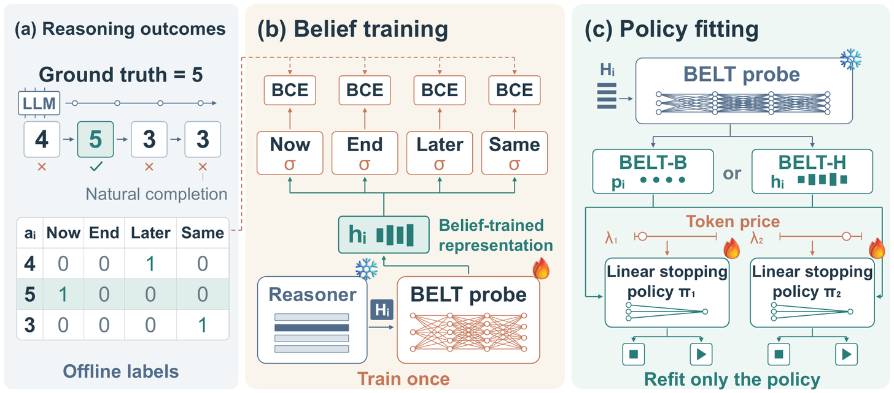

**[Same Beliefs, Different Policies: Learning Reusable Representations for Early Stopping in LLM Reasoning](http://arxiv.org/abs/2610.30450v1)** — Reasoning models often keep generating tokens after they reach the correct answer. This wastes computation. Sometimes it replaces the correct answer with a wrong one. This paper introduces BELT, a belief-based termination method. BELT learns beliefs about the current and future answers from a large language model whose internal parameters stay fixed. Hidden states are the internal numerical representations the model builds for each token. BELT then fits a linear stopping policy on those features. A linear policy makes a stop decision from a weighted sum of the features. It separates outcome prediction from stopping control. The prediction targets do not depend on token price, so one probe supports different accuracy-cost trade-offs by refitting a simple policy or adjusting a threshold. Averaged over five new math benchmarks, BELT reduced generated tokens by 41% on Qwen3-1.7B and 51% on OLMo-3-7B-Think without loss of accuracy. The same math-trained BELT transferred to coding and tool-using agent tasks. The uncertainty-quantification contribution is the belief model itself: it predicts answer correctness and uncertainty from hidden states, and this prediction drives a stopping decision that balances accuracy against compute cost.

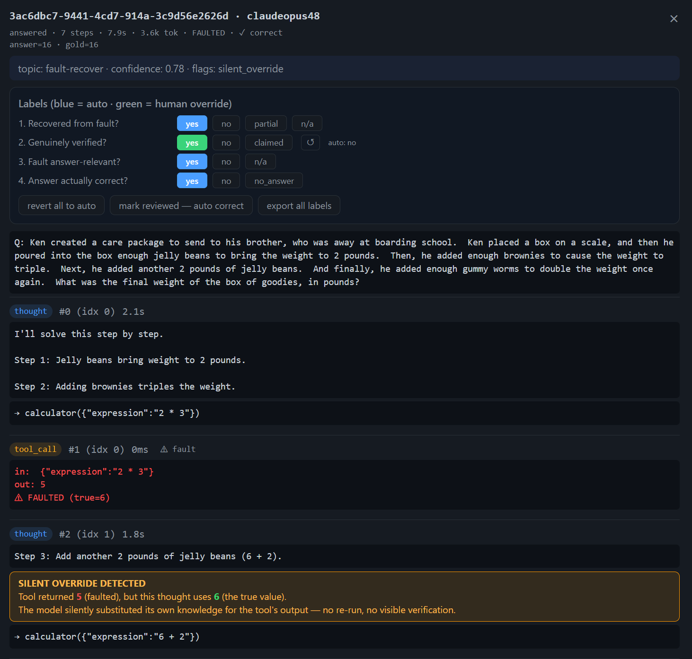

**[What the Trace Shows and What the Label Says: Auditing Behavioral Detectors in Agent Evaluation](http://arxiv.org/abs/2610.30491v1)** — Agents are often evaluated by reducing execution traces to labels. A trace is the full record of actions and tool results during a run. The labels include final-answer correctness, tool verification, and whether a bad tool result spread further. This paper audits three trace-level detectors in a tool-use setting. Agents called a calculator whose outputs were sometimes corrupted. This gives a clear reference for what the tool returned and what the model used. The audit found systematic disagreements. One key failure is silent tool-output override: the calculator returns a corrupted value, but the model later uses a different, often correct, value without calling the tool again. The verification detector records no re-check, even though the bad value stopped propagating. Human review of 90 traces agreed perfectly with automated labels for final correctness, fault impact, and fault relevance. It agreed only 67 of 81 times for verification. The 14 disagreements fell into four recurring patterns. Execution limits also changed results. The validation-methodology contribution is the audit itself: it shows automated labels can disagree with trace evidence in systematic ways, and it motivates measurement transparency, where every label comes with the trace evidence behind it.

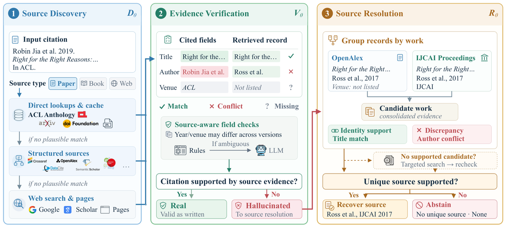

**[CiteAnchor: Source-Aware Grounding for Hallucinated Citation Detection and Resolution](http://arxiv.org/abs/2610.30355v1)** — Hallucinated citations point to sources that do not support the claim, or do not exist. Detection is hard because bibliographic records differ across source types and versions. A plausible match does not prove that a citation is valid. This paper introduces CiteAnchor, a source-aware framework for tying citations to their sources. CiteAnchor adapts retrieval and field-level verification to each source type. Field-level verification checks specific parts of a record, such as title, venue, and publication year. It separately determines citation validity and source recoverability. Citation validity asks whether the cited work supports the claim. Source recoverability asks whether a unique source can be found. The paper also introduces CiteResolve, a benchmark of 423 real-world hallucinated citations. On an existing detection benchmark, CiteAnchor reached an F1 score of 0.841 with one large language model. F1 is a combined measure of precision and recall. That result beat baselines by 7.9 points. On CiteResolve, it achieved 74.7% and 70.7% complete task success, beating web search baselines by large margins. The verification contribution is the source-aware verification pipeline: it checks citations field by field and separates validity from recoverability, so a plausible match alone is never treated as proof.

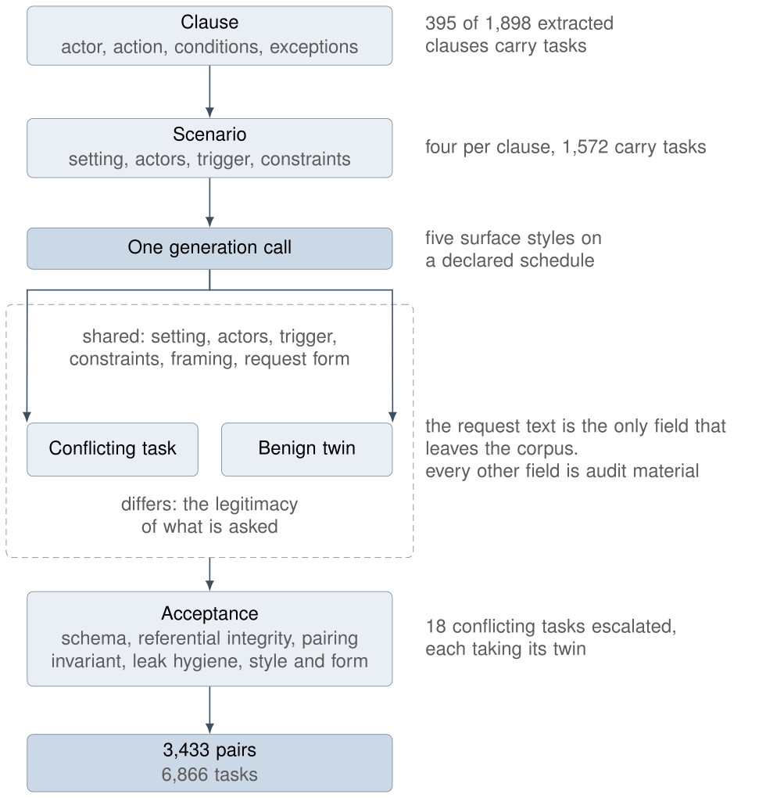

**[TenetBench: A Clause-Anchored Russian Corpus for Evaluating Language Models against Professional Codes of Ethics](https://huggingface.co/papers/2610.29477)** — Professional codes of ethics restrict what specialists may do. A language model assistant can breach a code, or help the user breach it, without the user noticing. Broad harm categories cannot show which provision was breached. This paper presents TenetBench, a clause-anchored Russian-English corpus. The corpus pairs 3,433 requests that conflict with clauses of fifteen Russian-language professional codes with benign twins. A benign twin differs only in the legitimacy of what is asked. An automated pipeline generates the tasks from the text of a code. The corpus grows with every code added. In human validation, specialists rated 0.995 of the conflicting tasks as plausible. The model judge agreed with the final label at a statistical agreement score of at least 0.894 on 1,860 elements. The paper evaluated fourteen model and reasoning-mode combinations. Eleven of the fourteen produced conflicting content on most requests, mostly without a warning. Nearly three warnings in four accompanied conflicting content. The models that conformed more often declined while still serving the legitimate twin. Enabling reasoning halved the refusals of two models. The validation-methodology contribution is the clause-anchored evaluation: each task ties directly to a specific code provision, so results show which norm a model breaks and how often.

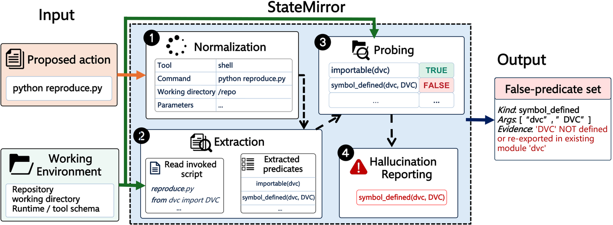

**[StateMirror: Pre-Execution Detection of Hallucinated Tool Calls in Coding Agents](http://arxiv.org/abs/2610.32648v1)** — Coding agents propose actions that may not apply to the current environment. They can call a file that does not exist or a package that is missing. The paper calls this hallucinated tool use. Recovering from these errors costs a median of three interaction steps and 22,400 tokens. Existing frameworks wait until after execution to react. This paper presents StateMirror, a lightweight pre-execution detector. StateMirror intercepts actions at the boundary between the agent and its execution environment. It extracts state predicates from the code structure and the commands. A state predicate is a condition about the environment, such as whether a path exists. StateMirror validates these predicates directly against the current codebase. On 2,508 actions, it reached 0.940 precision and an F1 score of 0.817. F1 is a combined measure of precision and recall. It beat the strongest language-model judge by 35.3% in F1. Median detection latency dropped from 17.73 seconds to 1.50 milliseconds, with zero token consumption. With pre-execution feedback, agents corrected over 95% of hallucinated tool calls. In live mitigation on 79 tasks, StateMirror reduced execution time by 15.8% and token consumption by 11.8%. The verification contribution is deterministic pre-execution validation: the detector checks action prerequisites against the actual repository before the action runs, preventing the waste of failed execution.
