# 17 New Ways to Verify, Validate, and Quantify AI Uncertainty

This week's list covers seventeen papers. One paper refines the taxonomy of hallucinations, separating confident wrong answers from hedged unknowns. A second wraps the formal verification tool UPPAAL in a language-model assistant that proposes, while UPPAAL verifies. A third introduces an AI-assisted evaluation pipeline that judges mathematics proofs and cuts false positives. A fourth builds controlled question rewrites to quantify answer uncertainty. A fifth generates targeted test data to expose semantic bugs in SQL queries. A sixth checks whether a security patch preserves behavior on non-crashing inputs. A seventh verifies computer-using agents by actively exploring the interface. An eighth measures whether every intermediate tool call in an agent's path is executable. A ninth has each agent in a collaboration report a calibrated confidence score. A tenth extends weighted programming with countable nondeterminism and mechanizes its soundness proofs. An eleventh introduces a reliability measure for Bayesian world models in offline multi-agent learning. A twelfth combines a Lean prover with a generated benchmark of verification tasks. A thirteenth adds a Cognitive Firewall that rejects weakly evidenced belief updates. A fourteenth detects hallucinations across unseen models using relational graphs. A fifteenth proves how many clean-sheet audits certify a low task-completion probability. A sixteenth intercepts agent actions before execution and verifies them. A seventeenth verifies formal guarantees for test-time compute on physics-structured AI memory.

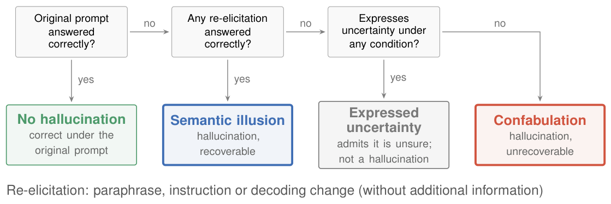

**[What Hallucinations Have We Measured? Semantic Illusion, Confabulation, and Expressed Uncertainty](http://arxiv.org/abs/2610.38520v1)** — Hallucination research uses one word for many different failures. A model can answer confidently and wrongly although it knows the answer. It can also answer confidently and wrongly because the knowledge is missing. Or it can hedge by saying it does not know. This paper argues these three cases need separate names and separate treatment. It proposes a strict taxonomy: expressed uncertainty, semantic illusion, and confabulation. Semantic illusion means the knowledge is accessible but applied inconsistently. Confabulation means the knowledge is absent or inaccessible. A simple re-elicitation test distinguishes the two: re-ask with a semantically equivalent prompt and see if the correct answer returns. Re-evaluating 14 detection and mitigation methods under this taxonomy shows detection methods flag expressed uncertainty more often than real hallucinations, and mitigation works far better for semantic illusions. The validation-methodology contribution is the refined taxonomy plus a practical labeling protocol that needs only a few semantically equivalent prompts, making hallucination research more valid.

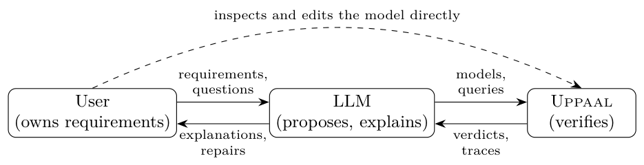

**[UPPAAi: Towards LLM-Assisted Modeling, Verification, Analysis and Synthesis](http://arxiv.org/abs/2610.40042v1)** — Formal verification tools check system models mathematically, but those tools are hard to use. Building a model, writing the properties to check, and interpreting a counterexample require expertise. UPPAAi attaches a large language model to the UPPAAL verification tool. The human asks for a modeling or analysis task. The language model proposes and explains a solution. Then UPPAAL itself runs the actual mathematical verification. UPPAAi gives the language model access to UPPAAL's editor and verifier through a tools API. Seven case studies cover timed automata, stochastic hybrid automata, and strategy learning. Timed automata are state-machine models with time constraints. The language model often suggested relevant UPPAAL features the user did not ask about. The verification contribution is the separation of duties: the language model can be wrong, so it proposes but never decides, and the UPPAAL engine remains the final authority on correctness. This makes formal verification more interactive and explainable for non-experts.

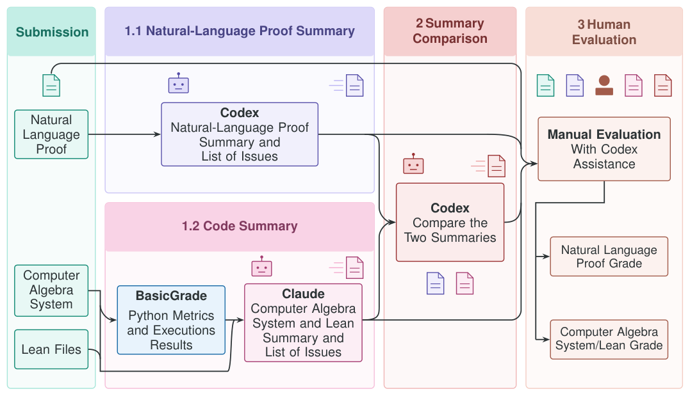

**[Ramanujan Challenge Results: AI-Assisted Evaluation Pipeline for Multi-Format Proofs](http://arxiv.org/abs/2610.40551v1)** — Judging whether a research-level mathematics proof is correct is hard even with AI. This paper analyzes submissions to the Ramanujan Challenge, a benchmark of number theory problems whose answers can be checked numerically but whose proofs require real mathematics. It introduces an AI-assisted evaluation pipeline for three proof formats: natural-language proofs, computer algebra system code, and Lean formalizations. Computer algebra systems perform symbolic mathematics. Lean is an interactive theorem prover, a computer system that checks a proof step by step according to strict logical rules. The pipeline assesses semantic and logical correctness rather than style. Compared with a single direct LLM judgment, the pipeline reduces false-positive verdicts on natural-language proofs from 23% to 6% and improves judgment accuracy on supporting code from 46% to 58%. The validation-methodology contribution is this more reliable evaluation pipeline, which can judge complex mathematical proofs at scale and could apply outside the Challenge.

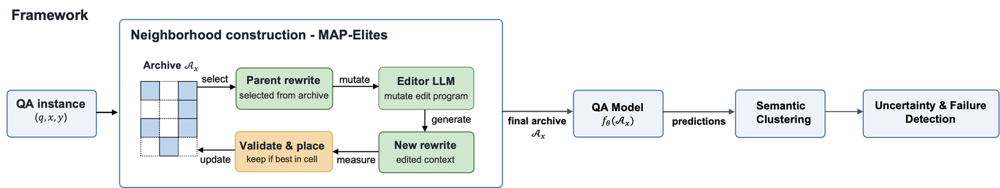

**[Neighborhood Elites: Quality-Diversity Search for Uncertainty Quantification in Question Answering](http://arxiv.org/abs/2610.40278v1)** — Question-answering systems can give a wrong answer that looks identical to a correct one. Perturbation-based uncertainty quantification rephrases the question several times and watches how much the answer changes. But ordinary paraphrasing does not control what changes or whether the context still supports the answer. Neighborhood Elites (NE) treats this as a search problem. It generates answer-preserving rewrites spread across two controlled axes: the kind of edit and how explicitly the context supports the answer. This design ensures the neighborhood covers a planned range rather than whatever a paraphraser happens to produce. Across five extractive question-answering datasets and five instruction-tuned models, NE reaches 0.726 AUROC, a standard detection-quality score, and a 0.211 lift in precision-recall over the base rate. It also beats semantic entropy, an existing method that samples many decoder outputs and measures agreement in meaning. The uncertainty-quantification contribution is a principled way to build input neighborhoods, with controlled axes instead of free paraphrasing, so the uncertainty estimate is designed rather than accidental.

**[LASSO: An LLM-Agent Synthesized System for SQL Validation](http://arxiv.org/abs/2610.38294v1)** — Text-to-SQL systems turn natural-language questions into database queries. A generated query can run without error and still return wrong rows because of a subtle semantic bug. Test datasets catch such bugs only if they trigger them. LASSO generates targeted test data for SQL validation using attack strategies, where each strategy targets one class of semantic error. Earlier tools relied on constraint solvers, which are slow and do not scale. LASSO prioritizes fast heuristics instead. The framework was built with LLM-based agentic coding, using careful workflows to avoid code-generation faults, and it contains internal test cases that catch errors in its own generated code. In evaluations across several benchmarks, LASSO outperformed the state-of-the-art SQL validation tools XData, SpotIT, ParSEval, and Polygon. The validation-methodology contribution is a scalable test-data generation framework based on targeted heuristics rather than slow solvers, making semantic SQL validation practical at scale.

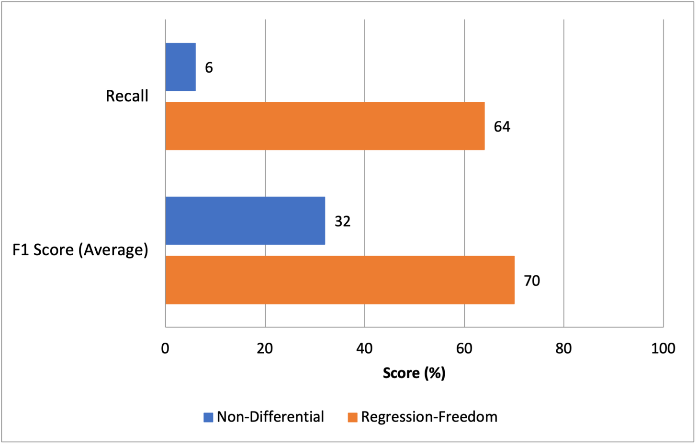

**[DeepDiff: Neuro-Dynamic Regression-Freedom Checking for Security Patch Validation](http://arxiv.org/abs/2610.39066v1)** — An AI-generated security patch can stop a crash and still be wrong. It might not remove the vulnerability, or it might break behavior that should stay intact. DeepDiff checks patches for regression-freedom. A regression is a loss of correct behavior on inputs that used to work. DeepDiff takes a candidate patch and the original vulnerable program, then runs non-crashing inputs that exercise the patched code paths. A correct patch should preserve behavior on those inputs while eliminating the crash. The framework offers a purely neural checker and a hybrid that combines dynamic analysis, running the program and observing its behavior, with neural techniques. It also releases a dataset of correct and incorrect patch candidates for memory-safety vulnerabilities. The validation-methodology contribution is the regression-freedom checking technique itself: it differentially evaluates a patch against the original program, so a patch is validated not just by passing tests but by preserving intended behavior on affected code paths.

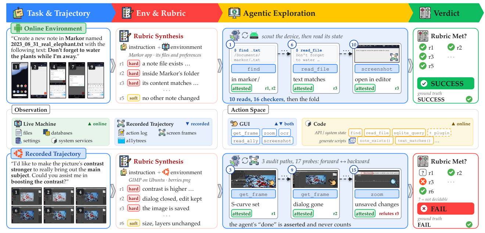

**[VeriCUA: Verification as Agentic Exploration for Computer-Using Agents](http://arxiv.org/abs/2610.40578v1)** — Computer-using agents operate a desktop, mobile, or web interface to complete tasks. Checking whether such an agent actually finished a task is difficult. A vision-language model can only see provided screenshots. A generated inspection program can only see accessible state. Key evidence may be absent. VeriCUA treats verification as active agentic exploration. Instead of passively judging, the verifier builds a task rubric from the context, then selects GUI or code checks for each unresolved requirement, and combines findings under explicit evidence rules. It works across platforms and supports online and offline modes. Experiments show better agreement with reference labels than baseline verifiers. The largest offline gains come on hard cases, and the framework rejects false completion claims more strongly online. The verification contribution is the shift from passive judgment to active evidence gathering: the verifier chooses what to inspect based on what remains unproven, and every conclusion must be supported by explicit evidence rules.

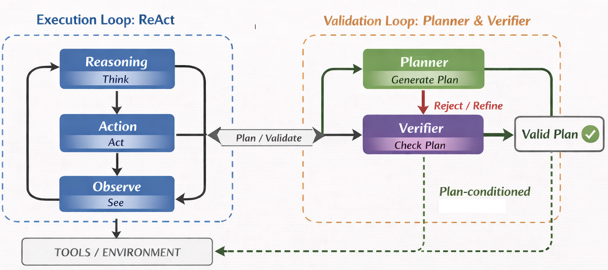

**[Prefix Executability: Evaluating Tool-Using Agents Beyond Final Success](http://arxiv.org/abs/2610.40444v1)** — Tool-use benchmarks usually score an agent by whether the final task succeeds. That score hides the path. An agent can reach the right final answer while many of its intermediate tool calls would fail. Prefix executability is a trajectory-level evaluation protocol that checks every prefix of the tool-call sequence. It asks whether each prefix is executable under the tool schemas, state preconditions, and data dependencies. The protocol summarizes reliability with Prefix Executability Curves, First-Error Depth, Trajectory Executability Rate, and Recovery Rate. Applied to BFCL-v3, ToolSandbox, and tau-cubed-bench, it shows that outcome-only success and prefix-level rankings diverge. Agents that follow an unverified plan can appear more successful by final score while having much lower trajectory executability. The validation-methodology contribution is a diagnostic protocol that exposes where invalidity first enters a trajectory and whether success follows recovery, rather than just whether success happened.

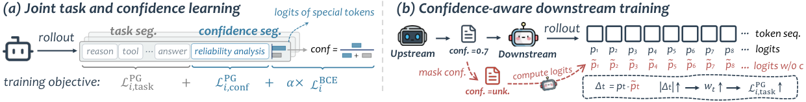

**[Learning Calibrated Confidence for Multi-Agent Collaboration](http://arxiv.org/abs/2610.39927v1)** — Multi-agent systems split a task among specialized agents. An upstream agent hands an intermediate answer to a downstream agent, which must decide whether to trust it or verify it. Most systems give no quantitative signal about how likely the answer is to be correct. MASCAL makes each agent learn a calibrated confidence probability for its answer, jointly optimizing task accuracy and calibration during reinforcement learning. Calibration means that when the model says 80% confident, it is right about 80% of the time. The upstream agent passes this probability at handoff, and the final answer also carries one. Training uses confidence-aware weighting, which increases learning weight at positions where the downstream agent actually uses the upstream signal. Across Web retrieval and reasoning tasks, MASCAL improves accuracy and calibration. The learned confidence also supports selective answering and targeted rechecking. The uncertainty-quantification contribution is a learned, calibrated confidence signal passed between agents, giving downstream decisions a quantitative basis for trust.

**[Countable Nondeterminism in Weighted Programming with an Application to Mechanized Foundations for Probabilistic Program Verification](http://arxiv.org/abs/2610.39723v1)** — Weighted programming is a way to describe optimization and probability problems as imperative programs, then analyze them with verification techniques. Earlier versions did not handle countable nondeterminism, meaning choices among infinitely many alternatives, or user-defined rewards. This paper extends the framework with both. It studies when weakest precondition reasoning stays sound. Weakest precondition reasoning computes the exact condition a program needs before running so that a desired property holds afterward. With countable nondeterminism, standard continuity assumptions break, so soundness is not automatic. The framework identifies conditions for soundness and proves them for several concrete instances. All definitions and proofs are mechanized in Lean, an interactive theorem prover that checks each proof step. Case studies cover expected resource use and optimal scores in combinatorial games. The verification contribution is the mechanized soundness result: the first mechanized proof that minimal expected rewards in Markov decision processes, models of sequential decisions under uncertainty, can be characterized by a fixed point.

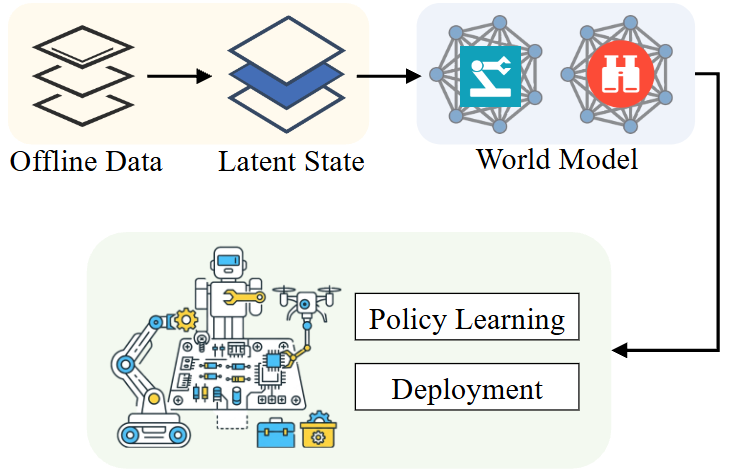

**[Bayesian Offline Multi-Agent Reinforcement Learning with Latent World Models](http://arxiv.org/abs/2610.39576v1)** — In multi-agent reinforcement learning, agents learn policies from their own observations. Offline learning uses pre-collected data, and the global state is often not recorded. The world model an agent learns can be wrong outside the data's coverage, and those errors mislead policy optimization. This paper proposes a Bayesian offline multi-agent framework. Bayesian means the model keeps a distribution of possible worlds and updates it as data arrives. The framework infers latent global states from decentralized histories and iteratively refines a posterior world model. It introduces Multi-Agent Posterior Information Loss (MPIL) as a reliability measure for world model refinement and offline evaluation. The theory shows an upper bound on policy regret that is monotonic in MPIL, and it characterizes dependence on data coverage. On multi-agent MuJoCo tasks, MPIL-guided refinement improves world model prediction and downstream policy. The uncertainty-quantification contribution is MPIL itself, a principled reliability measure for deciding when a learned world model can be trusted and when refinement is needed.

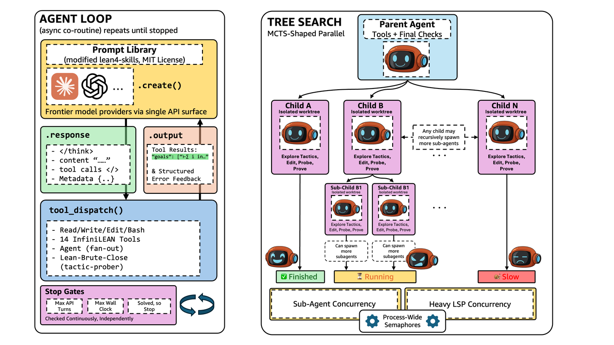

**[Scaling Lean Theorem Proving for Real-World Code Verification](https://huggingface.co/papers/2610.38174)** — Provable code verification requires formal proofs that a program meets its specification. Interactive theorem provers like Lean check those proofs step by step, but writing them is slow. EasyProver is a Lean proving system built from recursive agents, asynchronous search, and parallel tactic probing, using an off-the-shelf frontier model with no extra training. It proves almost all problems on existing Lean benchmarks. Because those benchmarks are near saturation, the paper also introduces Aegis, which converts competitive programming problems into verification tasks. Aegis writes safe Rust solutions, translates them into Lean, generates specifications, and labels each statement with a kernel-checked proof or refutation. Kernel-checked means the Lean kernel, a small trusted program, verifies every inference. On 2,000 sampled statements, EasyProver proves 52.7% within a 30-minute budget. The verification contribution is this pairing: a scalable theorem-proving system plus a benchmark of real implementation-level verification tasks suitable for training and evaluating other provers.

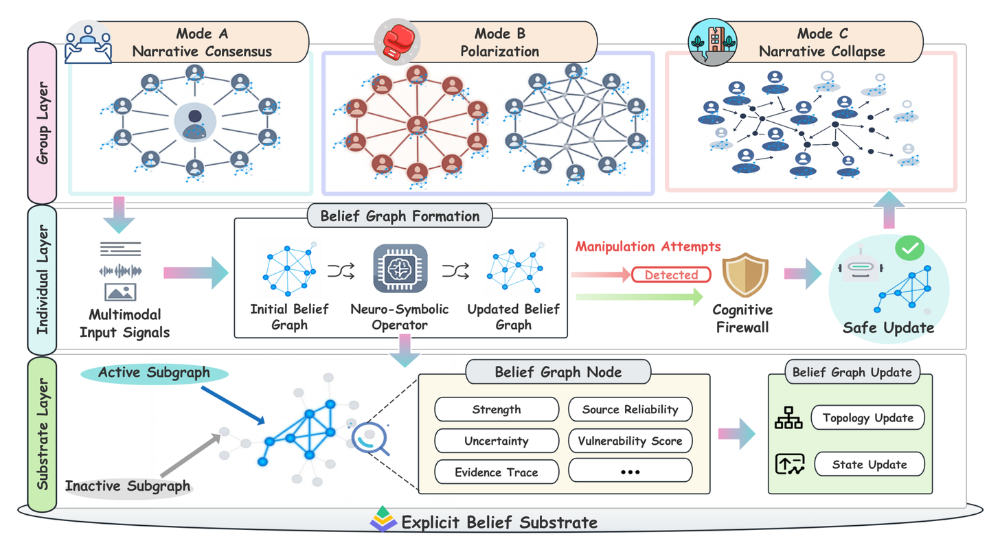

**[Auditable Belief Updates as a Missing Safety Layer for LLM-Powered Multi-Agent Systems](http://arxiv.org/abs/2610.38869v1)** — Multi-agent systems can pass a false belief from one agent to another until the group appears to agree. This paper treats belief as an engineering object, not a mental state. It defines belief as an evidence-based commitment that guides action. The proposed system, Explicit Belief Multi-Agent System (EB-MAS), stores each agent's beliefs in a structured external substrate. Belief operators propose candidate updates. A Cognitive Firewall then bounds or rejects updates that are weakly evidenced but strongly driven by vulnerability cues. Vulnerability cues are patterns that tend to trigger unsafe belief changes, such as social pressure or persuasive wording. The design makes belief revision traceable and auditable at runtime. The paper also describes group-level risks: manufactured consensus, collusion, and cascading misinformation. The verification contribution is the Cognitive Firewall itself: a runtime layer that constrains belief updates against evidence, so an agent cannot silently adopt a weakly supported claim just because the claim is persuasive.

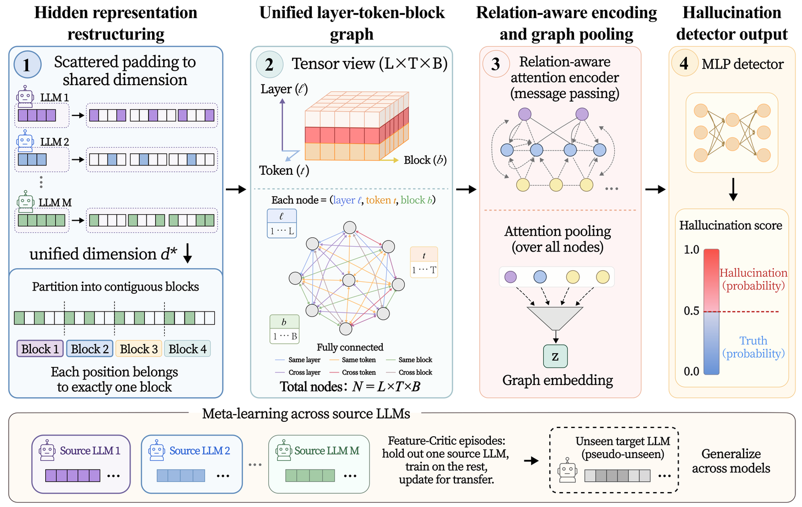

**[CHORD: Cross-Model Hallucination Detection via Relational Graph Discrimination](http://arxiv.org/abs/2610.38314v1)** — Hallucination detectors that look inside a model's hidden states work well on the model they were trained on. They often fail on a new model. The reason is representation heterogeneity: different models encode the same meaning in different internal patterns. CHORD is a cross-model hallucination detection framework. It takes hidden states from different models and represents them as joint relational graphs over layers, tokens, and features. A relational graph is a structure of nodes and edges that captures how parts relate to each other. Even when raw hidden states look different, these relational structures carry transferable signals. CHORD uses relation-aware attention to learn structure-aware features. It uses meta-learning, a training strategy that prepares a model to adapt to new tasks, to make those features transfer to unseen models. In experiments, CHORD outperformed representative detection methods on cross-model generalization. The verification contribution is the graph-based representation itself: by ignoring exact values and focusing on relations, a detector trained on source models can verify the outputs of unseen target models.

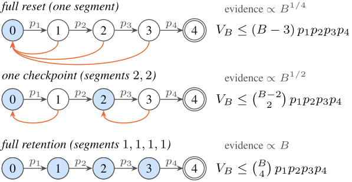

**[Clean Sheets and Checkpoints: Evidence Complexity for Certifying Sequential Agent Risk](http://arxiv.org/abs/2610.39124v1)** — Dangerous-capability evaluations test whether an AI agent can complete a harmful task. The test divides the task into ordered milestones, and a clean sheet records that the agent succeeded at none of the tested points. This paper asks a precise statistical question: how many clean sheets are needed to certify, with confidence one minus alpha, that the agent's true completion probability is at most epsilon? It models the task as a chain of milestones divided into checkpoint segments. For rare risks, each segment is either active, rarely completed within budget, or free, nearly always completed. The paper gives exact asymptotic bounds on the expected number of zero responses needed and shows the optimal certificate attains this bound. Every asymptotically optimal evaluator must divide its expected audit responses equally among active milestones. The verification contribution is the certificate itself: a formal guarantee, with proven sample-size bounds, that low observed success certifies a low true completion probability.

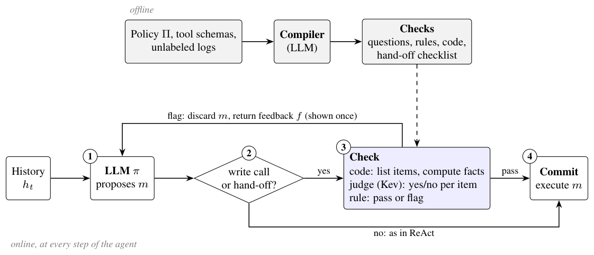

**[Think Before You Act: Decision Gate for LLM Agents](http://arxiv.org/abs/2610.38620v1)** — Language model agents take actions through external tools, and those actions often execute without any check. JevAct is a runtime verification framework that intercepts selected agent actions before execution. It compiles domain policies into executable state checks and structured questions. A prefill-only decision model evaluates those questions. Prefill-only means the model computes judgments directly from the prompt without generating free text, which makes the checks fast. The framework combines deterministic verification of tool-state facts with probabilistic assessment of conversational context. It can flag invalid actions and premature task termination, then provide targeted feedback for bounded revision. JevAct works with any underlying agent model and requires no parameter changes. Across eleven language model agents on airline and telecom tasks and the BFCL benchmark, it improved reliability, with consistent gains on Telecom and BFCL. The verification contribution is the interception layer itself: an external check that prevents invalid tool actions from executing, using both deterministic state checks and probability-based judgment.

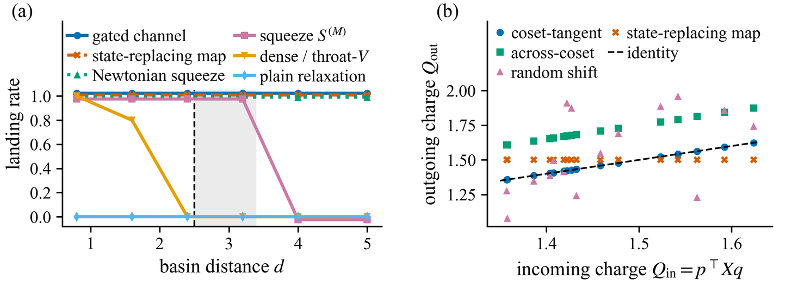

**[Certified Access: Test-Time Compute on Conservative Physics-Structured AI Memory](http://arxiv.org/abs/2610.39073v1)** — Some AI systems keep a learned internal model of the world and use it as memory. This paper builds a theoretical framework for spending test-time compute on such a memory, and it verifies the guarantees of that spending. The model is a Latent Dynamics Model: an encoder maps observations to a compressed state, and a learned Hamiltonian, an equation describing total energy, advances that state in time. The step is damped symplectic, a numerical method that preserves certain geometric properties. The framework provides exact phase-volume Jacobian, bounded energy change, and transport laws. It splits reachability failures into escape failures, where the state moves outside a permitted region, and reach failures, where it cannot reach a target. Two certified mechanisms fix them: a Lorentz squeeze for escapes and a gated canonical translation for reaches. The verification contribution is the formal certificate stack: proven bounds on energy cost and transported quantities, verified on an analytic testbed, giving a structural account of what extra compute buys rather than treating test-time compute as a black box.
