# 14 Ways to Verify, Validate, and Calibrate AI Systems

This week's list covers fourteen papers. One paper builds a tool that verifies discrete-time control systems with unknown dynamics, giving a probably approximately correct guarantee. A second reviews methods for verifiable logic in medical AI, focusing on reasoning trajectories rather than final answers. A third presents a runtime enforcement engine that checks agent actions against stateful security policies, with provable safety guarantees. A fourth introduces a formal framework for bounding quantization error in neural networks, using zonotope-based abstract interpretation. A fifth offers a benchmark that tests whether AI systems follow stated rules for handling missing information, revealing widespread failures. A sixth systematizes attacks and defenses in decentralized multi-agent systems, providing a cryptographic protocol for irrefutable execution traces. A seventh presents an end-to-end validation pipeline for LLM inference platforms used by agentic workloads. An eighth introduces a two-stage framework for detecting memory drift in LLM agents, using causal attribution. A ninth introduces a verification layer for autonomous energy systems that detects cyber-physical hallucinations. A tenth presents a pooled verification service for interactive theorem proving, designed to support prover training and multi-agent proving. An eleventh diagnoses rationale hallucination in multimodal safety guards and proposes a reinforcement learning method to ground them. A twelfth audits success checkers in simulated manipulation benchmarks, finding phantom successes and silent failures. A thirteenth studies how the design of scoring schemes affects LLM-as-a-judge evaluations. A fourteenth audits scale-direction bias in LLM judges, showing that many fail to follow rubric semantics.

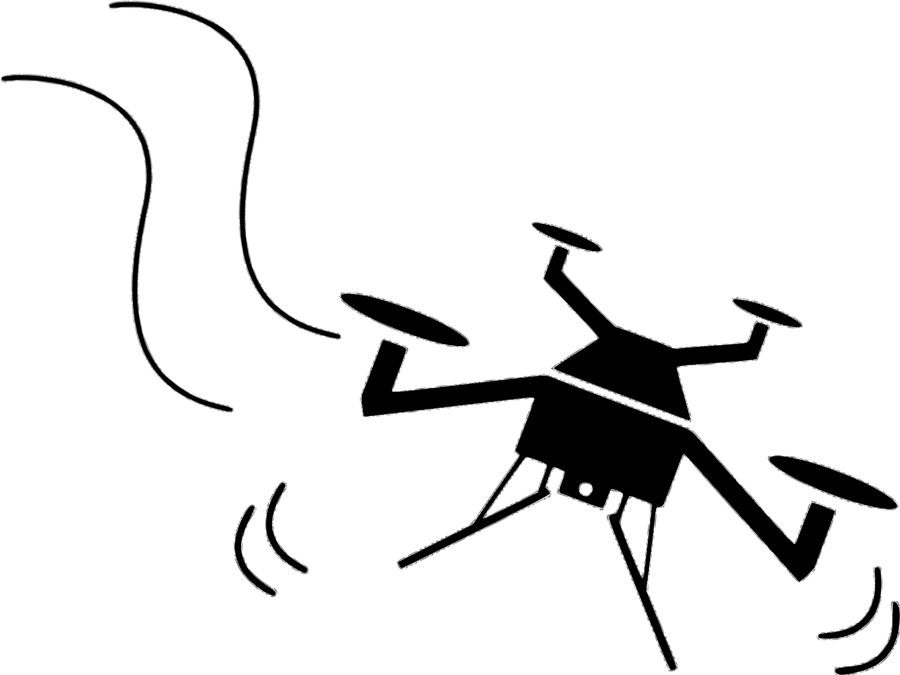

**[DARSY: A Tool for Data-Driven Abstraction and Policy Synthesis for Stochastic Systems with Unknown Dynamics](http://arxiv.org/abs/2611.25654v1)** — Stochastic control systems with unknown dynamics and noise distributions are common in robotics and cyber-physical systems. Standard verification requires a mathematical model of the system, which is often unavailable. DARSY is a software tool that requires only a simulator and a Lipschitz bound, a number that limits how fast the system's behavior can change with the input. DARSY builds a finite model called an interval Markov decision process (IMDP) from sampled transitions, using statistical techniques and Lipschitz reasoning to derive probability intervals. Robust dynamic programming on this IMDP produces a policy and a lower bound on the probability that the system satisfies a desired specification, such as reaching a goal state while avoiding obstacles. This lower bound holds with a user-specified confidence, meaning it is probably approximately correct (PAC). The verification contribution is this PAC guarantee: the tool returns a provable bound on satisfaction probability without knowing the system's true dynamics, using only sampled data and the Lipschitz bound.

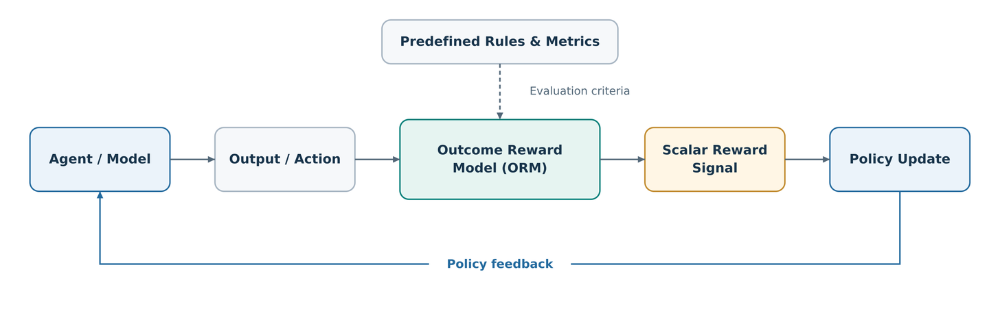

**[Verifiable Logic in Medical LLMs: A Critical Review of Agentic Clinical Reasoning Optimization and Neuro-Symbolic Grounding](http://arxiv.org/abs/2611.25898v1)** — Clinical large language models are judged mostly on whether the final answer is correct. This paper argues that a model can reach a correct answer through invalid reasoning, and that static benchmarks miss this problem entirely. The review covers four paradigms: how hallucination arises in clinical settings, the agentic hallucination cascade where multiple agents amplify early errors, process reward modeling that gives feedback at each reasoning step, and neuro-symbolic grounding where formal logic engines and knowledge graphs place verifiable constraints on neural output. Systems with symbolic veto layers can offer guarantees that hold relative to their encoded knowledge, but the paper notes these results come from small simulated studies. The verification contribution is a conceptual framework that maps each agentic failure mode to a symbolic intervention point, arguing that responsible certification should audit reasoning trajectories, not just final accuracy.

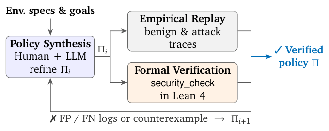

**[Tether: Verified Stateful Policy Engine for System-Level Monitoring of Agents](http://arxiv.org/abs/2611.25599v1)** — Autonomous agents execute arbitrary shell commands over long tasks. A single command can make unauthorized network requests or permanently alter the user's file system. Existing defenses use LLM-based monitors with no provable safety guarantees, or stateless policy layers that miss multi-step data flows. Tether enforces stateful security policies at runtime. For each proposed action, Tether executes the action in an isolated sandbox, then infers abstract semantics from the system calls it observes. Policies are defined in Lean 4, a language for formal verification, and can express information flow control, access control, and network security rules. Because actions propagate labels from sources to destinations, a single rule can enforce fine-grained policies across arbitrarily long execution chains. The verification contribution is this: expressing policies in Lean enables formal verification that they satisfy global security invariants, such as preventing network access after reading a sensitive file. On coding-agent benchmarks, Tether blocks 100% of in-scope attacks with under 5% false positives.

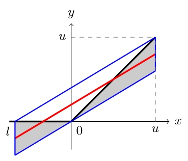

**[Zonotopic Analysis of Quantization Error in Neural Networks](http://arxiv.org/abs/2611.24648v1)** — Neural networks are quantized to reduce precision for faster computation on limited hardware. Quantization introduces rounding and clamping errors, and bounding these errors is a challenge because the operations are discrete, not continuous. This paper presents a formal framework for quantized ReLU feed-forward networks using zonotopes, a geometric shape that can track error ranges through a network. The key idea is a unified round-clamp abstract transformer that handles both discrete rounding and clamping together. The paper extends this to constrained zonotopes, which add linear constraints to tighten the error bounds. The framework is proven sound and optimal for both formulations. On the ACAS Xu benchmarks for aircraft collision avoidance, the constrained zonotope method reduces average error-bound widths by 70 to 85% and runtimes by 65 to 80% compared to prior symbolic propagation at small perturbation radii. The verification contribution is the formal, sound, and optimal zonotope method for bounding quantization error.

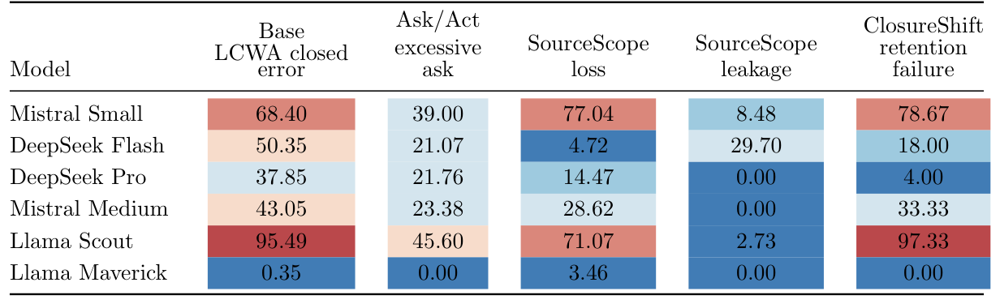

**[ClosureBench: A Benchmark for Reasoning under Closure Assumptions](http://arxiv.org/abs/2611.26335v1)** — AI agents often answer questions from incomplete records. A missing fact might mean "unknown" or "false," depending on the context. Current evaluations do not separate these two interpretations. ClosureBench tests whether language models follow the stated rules for handling missing information. Each scenario is tested under three closure assumptions: open-world (missing information is unknown), closed-world (missing information is false), and local closed-world (some information sources are complete, others are not). A model is considered correct on a scenario only if it answers correctly in all three variants. Across 960 instances, overall accuracy ranged from 71 to 99%. However, core switch accuracy, measured on scenarios where the correct answer actually changes with the closure assumption, varied from 18 to 99%. The validation-methodology contribution is this benchmark design: by isolating the treatment of missing information and requiring a model to pass all three variants, it reveals whether a model truly understands the rule it is supposed to follow, not just whether it can reason over existing facts.

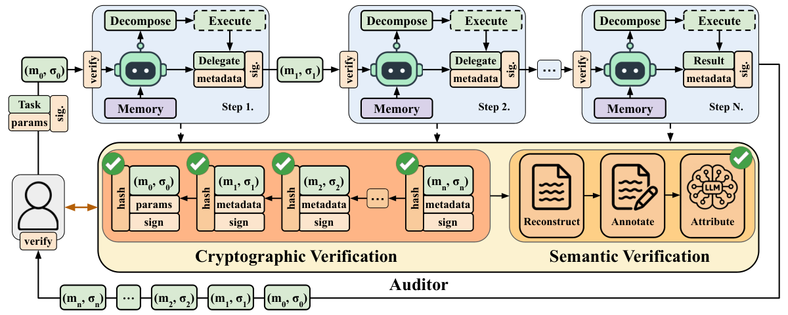

**[Attacks and Defenses in Decentralized Multi-Agent Systems with Hop-by-Hop Task Decomposition and Delegation](http://arxiv.org/abs/2611.25056v1)** — Decentralized multi-agent systems let independently administered agents collaborate without central coordination. Each agent can have its own model, memory, and configuration. This structure is scalable, but it creates security challenges because no single entity has full visibility or authority. This paper first systematizes the threats. A single malicious agent can cause up to 100% task failure, inflate token consumption by up to 7.7x, and exfiltrate up to 94% of prior tasks from benign agents. The paper then presents a cryptographic protocol that produces an irrefutable verified execution trace of every action taken. An auditor analyzes these traces to detect and attribute malicious behavior, achieving 98% detection and correct attribution even for attacks that comply with the protocol. The verification contribution is the protocol itself: it makes each action provable and attributable, enabling a decentralized system to hold agents accountable without a trusted central authority.

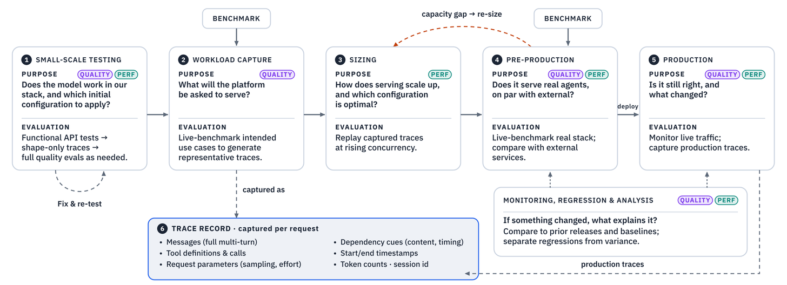

**[Validation-driven Deployment of LLM Inference Platforms for Agentic Workloads](http://arxiv.org/abs/2611.25905v1)** — Enterprises are moving AI workloads from closed APIs to their own model deployments. This shift requires lifecycle-wide validation, but typical rollouts use ad hoc tools with unverified accuracy. This paper presents an end-to-end evaluation pipeline that covers small-scale testing, sizing, pre-production, and production. The key empirical finding is that replaying captured traces reproduces per-session load within 1.18x of the recorded input tokens, while live re-runs reach 4.98x. This means a small set of recorded sessions yields a repeatable test load. A code-coverage analysis of the vLLM serving system shows that live, replayed, and synthetic workloads are complementary, each exercising code paths the others miss. In a case study with four mixture-of-experts models, the pipeline revealed that the models reached about half the optimal concurrency and 60% of the throughput on captured workloads compared with public traces. The validation-methodology contribution is this empirically grounded pipeline, which provides reliable design choices for deployment validation instead of relying on untested assumptions.

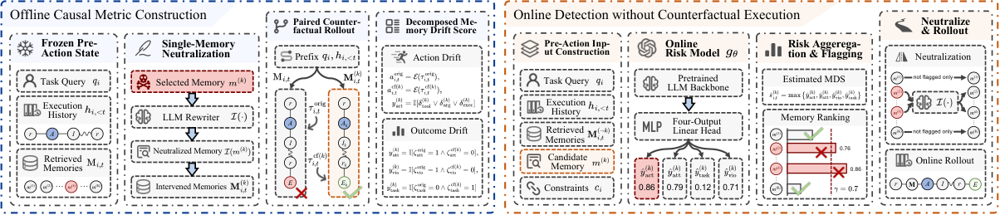

**[DriftGuard: Online Memory-Drift Detection via Causal Attribution for LLM Agents](http://arxiv.org/abs/2611.25583v1)** — LLM agents rely on persistent memory to plan and execute multi-step tasks. An adversarial or misleading memory can alter the entire execution path, a problem called memory drift. Detecting this drift online, at serving time, is difficult because checking every candidate memory would require expensive replays of the agent and its tools. DriftGuard decouples the problem into two stages. First, offline, it runs paired counterfactual replays: it continues the original trajectory and a trajectory where a single memory is neutralized, from the same pre-action state. The difference produces a memory drift score that captures action change, attack removal, violation removal, and task recovery. Second, an online risk model learns to estimate this score from pre-action information alone, without any online replays. The verification contribution is this two-stage framework: it provides real-time detection of drift-inducing memories with a causal attribution that would be prohibitively expensive to compute directly at runtime.

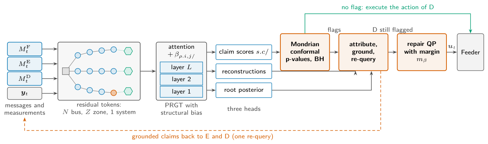

**[GridAnchor: Specialized Multi-Agent AI for Safeguarding Autonomous Energy Systems Against Cyber-Physical Hallucinations](http://arxiv.org/abs/2611.25158v1)** — Autonomous energy systems chain together agents for forecasting, state estimation, and dispatch. A forecaster can output a confident prediction that contradicts physics, and downstream agents may act on it. This paper defines such errors as cyber-physical hallucinations and organizes them into eight types. GridAnchor is a verification layer that scores every claim from the residuals between the claim, the measurements, and a linearized grid model. It uses Mondrian conformal p-values with a statistical correction to turn scores into decisions. If a claim is flagged, a quadratic program repairs the unsafe action. On a simulated rural feeder, GridAnchor achieves a precision-recall curve area of 0.846, close to the best baseline. In closed-loop tests, it leaves no bus outside the voltage band on test days, compared to 0.07% of bus-steps without protection. The verification contribution is GridAnchor itself: a specialized verification layer that catches expert claims contradicting physics, protects the grid, and does so with statistically calibrated decisions.

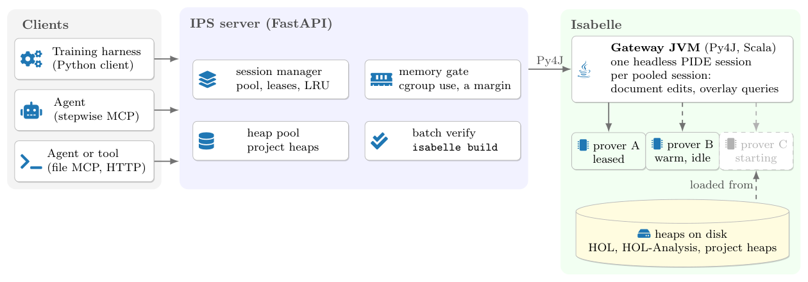

**[Isabelle Pool Server: a pooled verification service for prover training and multi-agent proving](http://arxiv.org/abs/2611.24788v1)** — Interactive theorem provers like Isabelle require a running session to check proofs. Starting a new session is slow, and managing many sessions for training AI provers or multi-agent proving is complex. Isabelle Pool Server (IPS) provides a pooled verification service with a set of warm, headless Isabelle sessions behind an HTTP API. Clients can lease a session, run a single proof step or a full theory build, and reclaim the session when done. Checkpoints allow cheap branching and backtracking. The service includes memory-aware admission control and a time budget on every call. In tests, IPS matches a direct PIDE interface at one worker and outperforms it at eight workers. The verification contribution is the service design: it scales to 32 concurrent workers on one host at 24 times the single-worker rate, refuses new sessions under memory pressure instead of losing existing ones, and provides a standardized API that allows AI agents and training pipelines to verify proofs efficiently.

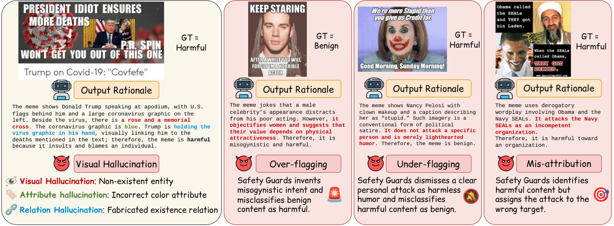

**[When Safety Rationales Hallucinate: Diagnosing and Grounding Multimodal Safety Guards](http://arxiv.org/abs/2611.25793v1)** — Multimodal safety guards now often generate a rationale alongside a safety prediction. A rationale might say "the image contains a knife" and give the reason. This paper systematically studies whether these rationales are reliable. It finds two types of hallucination: visual rationale hallucination, where the rationale contains unsupported visual facts, and safety attribution hallucination, where grounded content is assigned an incorrect safety meaning. Across multiple methods and models, hallucination is widespread and does not decrease with better classification accuracy or larger model size. The paper proposes Tool-Contrastive Grounding Reinforcement Learning (TCG-RL), which rewards the guard for using a visual tool only when that tool improves the rationale's grounding compared to a tool-free reference. The verification contribution is TCG-RL: it substantially reduces rationale hallucination while maintaining safety prediction performance, shifting the goal from outcome-only evaluation toward safety decisions that are both accurate and verifiably grounded.

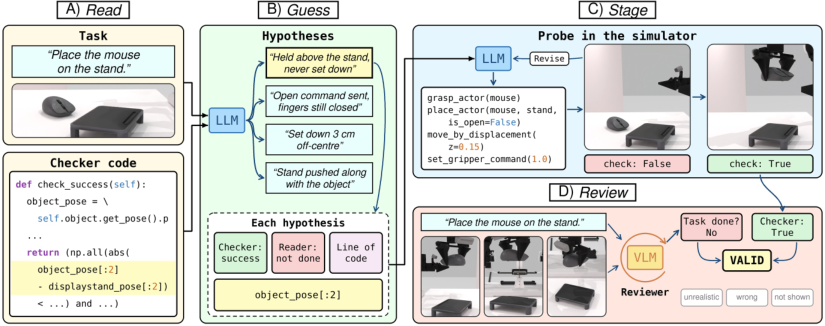

**[Phantom Success, Silent Failure: Auditing the Success Checkers of Simulated Manipulation Benchmarks](https://huggingface.co/papers/2611.25179)** — Simulated manipulation benchmarks measure policy performance using hand-written success checkers. A checker labels each episode as success or failure. Passing an expert demonstration shows the checker accepts one way of completing the task, but learned policies may do the task differently or stop partway. The checker might then accept an incomplete execution (phantom success) or reject a valid one (silent failure). SimAudit is an LLM-based pipeline that audits these checkers. It reads the task instruction and the checker code to identify where they might disagree, recreates those scenarios in simulation, and uses multi-view renderings to verify whether the behavior satisfies the instruction. Across three benchmarks, 183 simulated test cases produced the predicted verdict, yielding 61 distinct defects across 49 tasks: 40 phantom successes and 21 silent failures. The validation-methodology contribution is SimAudit itself: it exposes that success checkers need testing on both incomplete executions and valid alternatives, not just expert demonstrations, and motivates more rigorous validation protocols.

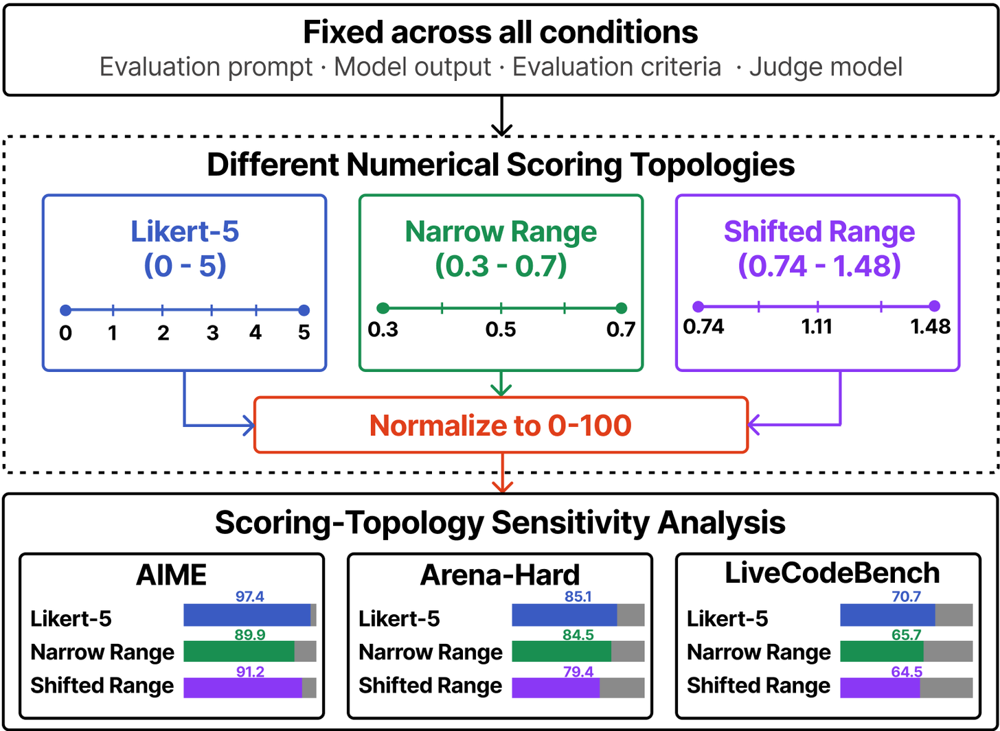

**[Same Judgement, Different Scores: Numerical Scoring Topology in LLM-as-a-Judge Evaluation](http://arxiv.org/abs/2611.26077v1)** — LLMs are increasingly used as automated judges to evaluate other AI systems. The score a judge gives depends on the design of the scoring scheme: how many points the scale has, how wide it is, where the midpoint sits, and how symmetric it is. This paper introduces numerical scoring topology as a way to characterize these design choices. It systematically studies how each element of the topology affects judge scores, calibration, and robustness across several benchmarks and judge models. The results show that shifted and narrow ranges cause the largest score deviations. Stronger and larger judge models are more robust to changes in the scoring topology. The validation-methodology contribution is the discovery that the scoring scheme is not a neutral measurement tool; it is an integral part of the evaluation method. The paper argues for principled and standardized scoring protocols to ensure that LLM-as-a-Judge evaluations are reliable and comparable.

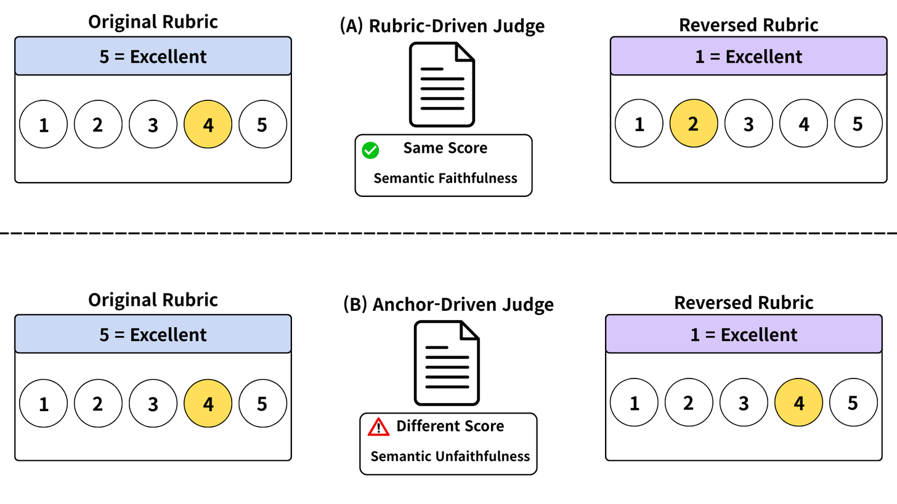

**[Rubric Semantics or Numerical Priors? Auditing Scale-Direction Bias in LLM Judges](http://arxiv.org/abs/2611.25588v1)** — LLM judges are assumed to evaluate based on the rubric's semantic meaning, not its numeric scale. This paper calls that assumption into question. It introduces semantic faithfulness: the principle that semantically equivalent rubrics must yield consistent scores. To measure this, the paper proposes a scale-reversal probe that swaps the score anchors, so a 1-to-5 scale becomes a 5-to-1 scale, without changing the evaluation criteria. If the judge is truly following the rubric's meaning, the reversed scores should be the inverse of the original scores. A floor normalization step calibrates the reversal disagreement against the model's own intrinsic variability. Across five benchmarks and seven judge models, the probe finds widespread violations of semantic faithfulness. The validation-methodology contribution is the scale-reversal probe itself: it provides a concrete test for whether an LLM judge reliably follows rubric semantics, showing that many judges that correlate well with human ratings still fail this fundamental test.
